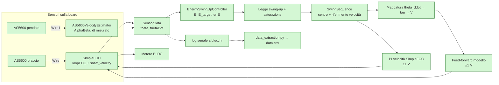

# Pendolo di Furuta — modello non lineare, simulazione e controllo

Questo repository raccoglie il codice C++17 e gli strumenti di sviluppo per un **pendolo di Furuta**: un sistema meccanico *sottattuato* (due gradi di libertà, un solo attuatore), fortemente non lineare, usato come banco di prova per tecniche di controllo. L'obiettivo del progetto è portare il pendolo dalla posizione di riposo (appeso) alla verticale tramite una legge di **swing-up a energia** e, in prospettiva, mantenerlo in equilibrio con un controllore di stabilizzazione.

> **Stato del progetto.** Il solutore Runge-Kutta 4 e il controllore di stabilizzazione in cima sono **design previsto e non ancora implementati**; la tabella in [§11](#11-stato-dellimplementazione-e-roadmap) distingue ciò che è operativo da ciò che è pianificato. Il resto è codice reale: parametri, modello dinamico, filtri di velocità, energia e legge di swing-up (con target sotto la verticale), sequenza di avvio (`swing_sequence.hpp`), mappatura $\ddot\theta \to \tau \to i \to V$, stima di $k_t$/$k_V$, smoke test host (`main.cpp`) e firmware board (`main.ino`, SimpleFOC + due AS5600), di cui esiste un primo log del banco in `data/data.csv`.

## Indice

- [1. Il sistema fisico](#1-il-sistema-fisico)
- [2. Hardware e catena di attuazione](#2-hardware-e-catena-di-attuazione)
- [3. Convenzioni, simboli e parametri](#3-convenzioni-simboli-e-parametri)
- [4. Modello dinamico non lineare](#4-modello-dinamico-non-lineare)
- [5. Integrazione numerica: Runge-Kutta 4](#5-integrazione-numerica-runge-kutta-4)
- [6. Stima della velocità dagli AS5600](#6-stima-della-velocità-dagli-as5600)
- [7. Controllo di swing-up a energia](#7-controllo-di-swing-up-a-energia)
- [8. Dall'accelerazione comandata al motore](#8-dallaccelerazione-comandata-al-motore)
- [9. Architettura software](#9-architettura-software)
- [10. Build ed esecuzione](#10-build-ed-esecuzione)
- [11. Stato dell'implementazione e roadmap](#11-stato-dellimplementazione-e-roadmap)
- [12. Riferimenti](#12-riferimenti)

---

## 1. Il sistema fisico

Il pendolo di Furuta (o *rotational inverted pendulum*) è composto da:

- un **braccio** (nel codice `PinwheelParameters`, massa $m_1$) che ruota in un piano orizzontale attorno all'asse di un motore;
- un **pendolo** (massa $m_2$) incernierato all'estremità del braccio, libero di ruotare in un piano verticale.

Il sistema ha due gradi di libertà, $\theta$ (braccio) e $\alpha$ (pendolo), ma un solo attuatore: la coppia $\tau_1$ del motore agisce solo su $\theta$. La cerniera del pendolo è **passiva** ($\tau_2 = 0$): è questo che rende il sistema *underactuated*.

Due equilibri notevoli:

| Configurazione | $\alpha$ | Stabilità | Energia del pendolo |
|---|---|---|---|
| pendolo appeso (riposo) | $0$ | stabile | $E = 0$ |
| pendolo verticale (in piedi) | $\pi$ | instabile | $E = E^\star = 2m_2gl_2$ |

La nonlinearità nasce da tre sorgenti:

1. la **gravità**, che genera una coppia $\propto \sin\alpha$ sulla cerniera;
2. i termini **centrifughi e di Coriolis**, che accoppiano $\dot\theta$ e $\dot\alpha$ (termini $\propto \sin 2\alpha$ e $\propto \sin\alpha\,\dot\alpha^2$);
3. l'**inerzia del braccio vista dal motore**, che dipende dalla posizione del pendolo: $\hat J_0 + \hat J_2\sin^2\alpha$.

Lo schema di riferimento è la Fig. 1 della pagina Wikipedia [Furuta pendulum](https://en.wikipedia.org/wiki/Furuta_pendulum), da cui il progetto ha ripreso geometria e convenzioni.

---

## 2. Hardware e catena di attuazione

I limiti dell'attuatore sono raccolti in `ActuatorLimits` (`furuta/include/furuta/parameters.hpp`):

| Parametro | Valore | Note |
|---|---|---|
| `maxRPM` | 3850 | regime massimo dell'asse, $\approx 403\ \mathrm{rad/s}$ |
| `voltage` | 24 V | tensione di alimentazione |
| `poles` | 8 | coppie polari motore BLDC — **non usato oggi** |
| `nPower` | 50 W | potenza nominale |
| `nRPM` | 3000 | velocità nominale |
| `phaseResistance` | 1.38 Ω | resistenza di fase **provvisoria**, da identificare ([§8](#8-dallaccelerazione-comandata-al-motore)) |
| `maxTorque`, `maxCurrent` | *(vuoti)* | da identificare/dichiarare |
| `mode` | 0 | selettore delle formule di $k_t, k_V$ (vedi [§8](#8-dallaccelerazione-comandata-al-motore)) |

La misura degli angoli è affidata a **due encoder magnetici AS5600** (12 bit assoluti, 4096 conteggi/giro, $1\ \mathrm{LSB} = 2\pi/4096 \approx 1.53\ \mathrm{mrad}$), uno sul braccio e uno sulla cerniera del pendolo, letti via I2C.

Stato attuale della catena:

- il **firmware board** è `furuta/src/main.ino`: [SimpleFOC](https://simplefoc.com/) pilota il motore e legge l'AS5600 del braccio sul bus `Wire`; il pendolo è letto sull'altro bus `Wire1`, perché i due AS5600 condividono l'indirizzo I2C `0x36`. La velocità del braccio arriva da `motor.shaft_velocity`, quella del pendolo da uno stimatore AlphaBeta con $\Delta t$ misurato;
- **`main.cpp`** è invece uno *smoke test* host: ricalcola $\mathrm{errE} \to \ddot\theta_{cmd} \to \tau$ e l'inversa del modello, senza filtri né loop di controllo. La funzione mock `getAngles(t)` è rimasta nel file ma non è più usata.

---

## 3. Convenzioni, simboli e parametri

### 3.1 Convenzioni angolari

Le convenzioni sono quelle di [Cazzolato & Prime (2011)](https://downloads.hindawi.com/journals/jcse/2011/528341.pdf), riprese da Wikipedia e già coerenti con il codice:

- $\theta$ (braccio): angolo nel piano orizzontale, positivo **antiorario visto dall'alto**;
- $\alpha$ (pendolo): angolo nel piano verticale, positivo **antiorario visto di fronte**, con $\alpha = 0$ quando il pendolo è appeso verso il basso e $\alpha = \pi$ quando è verticale in alto;
- $\tau_1$: coppia motrice, positiva concorde a $\theta$ (antioraria vista dall'alto);
- $\tau_2 = 0$: la cerniera del pendolo non è attuata.

Il codice è internamente coerente con questa scelta: l'energia implementata in `energy_swing_up.hpp`, $E = \frac12 \hat J_2\dot\alpha^2 + m_2gl_2(1-\cos\alpha)$ (con $\hat J_2$ = `J_yy`), vale $0$ da fermo in basso ($\alpha = 0$) e $E^\star = 2m_2gl_2$ da fermo in alto ($\alpha = \pi$).

### 3.2 Tabella dei simboli

| Simbolo qui | Codice (`parameters.hpp` / altro) | Wikipedia/Cazzolato | Significato |
|---|---|---|---|
| $m_1$ | `PinwheelParameters::pinwheelMass` | $m_1$ | massa del braccio |
| $l_1$ | `PinwheelParameters::pinwheelToCoM` | $l_1$ | distanza asse motore → CoM del braccio |
| $L_1$ | `PinwheelParameters::pendulumToCenter` | $L_1$ | distanza asse motore → cerniera del pendolo (il nome nel codice è fuorviante) |
| $m_2$ | `ArmParameters::pendulumMass` | $m_2$ | massa del pendolo |
| $l_2$ | `ArmParameters::pendulumToCoM` | $l_2$ | distanza cerniera → CoM del pendolo |
| $L_2$ | `ArmParameters::pendulumLenght` | $L_2$ | lunghezza del pendolo (refuso `Lenght` nel codice) |
| $\hat J_2$ | `ArmParameters::J_yy` | $\hat J_2 = J_{2zz} + m_2l_2^2$ | inerzia del pendolo rispetto alla **cerniera** (già comprensiva del trasporto) |
| $J_{2xx}$ | `ArmParameters::J_xx` | $J_{2xx}$ | componente trasversale del tensore d'inerzia del pendolo — **non usata oggi** |
| $\hat J_0$ | calcolata in `FurutaDynamics` da `pinwheelInertia` + termini di trasporto | $\hat J_0 = J_1 + m_1l_1^2 + m_2L_1^2$ | inerzia totale vista dal motore con pendolo in basso |
| $b_1, b_2$ | `FrictionParameters::armViscous`, `pendulumViscous` | $b_1, b_2$ | attriti viscosi (motore e cerniera) — struct presente, valori **non identificati** (default 0) |
| $R$ | `ActuatorLimits::phaseResistance` | — | resistenza di fase, **provvisoria** (1.38 Ω): entra in $V = Ri + k_e\dot\theta$ ([§8](#8-dallaccelerazione-comandata-al-motore)) |
| $\mu$ | `mu` | — | costante dichiarata ma **mai usata**; semantica da chiarire (candidato: attrito) |
| $g$ | `gravity` | $g$ | accelerazione di gravità |

### 3.3 Parametri numerici

Geometria e inerzie provengono dal CAD (`dimensions.txt`: J1 = braccio, J2 = pendolo, origine di J2 sulla cerniera).

| Parametro | Valore | Unità |
|---|---|---|
| $m_1$ | 0.096567 | kg |
| $l_1$ | 0.0070202 | m |
| $L_1$ | 0.079073 | m |
| $m_2$ | 0.021332 | kg |
| $l_2$ | 0.066611 | m |
| $L_2$ | 0.0859 | m |
| $\hat J_2$ (`J_yy`) | $1.0513\times10^{-4}$ | kg·m² |
| $J_{2xx}$ (`J_xx`) | $9.9256\times10^{-7}$ | kg·m² |
| $g$ | 9.81 | m/s² |

Per $L_2$: l'altezza del bounding box CAD del pendolo è 97.9 mm, di cui 12 mm di materiale di accoppiamento sopra la cerniera.

Grandezze derivate utili:

$$m_2gl_2 = 1.394\times10^{-2}\ \mathrm{J}, \qquad E^\star = 2m_2gl_2 = 2.788\times10^{-2}\ \mathrm{J}, \qquad m_2L_1l_2 = 1.124\times10^{-4}\ \mathrm{kg\,m^2}$$

$$\dot\theta_{max} = 2\pi\frac{3850}{60} \approx 403\ \mathrm{rad/s}$$

**Incertezze note da chiarire** (finiscono nella roadmap):

- $\hat J_2$ è il valore CAD (trasporto alla cerniera incluso): è circa il doppio della stima di un'asta uniforme ($m_2L_2^2/3 \approx 5.25\times10^{-5}\ \mathrm{kg\,m^2}$), coerente con la massa concentrata verso la punta ($l_2/L_2 \approx 0.78$);
- `J_xx` è il momento rispetto all'asse longitudinale del pendolo ($\approx 0$ per un pendolo snello) e non entra né nel modello semplificato né nel codice attuale;
- $b_1, b_2$ hanno una struct (`FrictionParameters`) ma restano a 0, e `phaseResistance` è un valore di partenza da identificare;
- `mu` è dichiarata ma non compare in nessuna formula;
- $\hat J_0$ usa $J_{1zz}$ dal CAD **rispetto al CoM** ($8.3141\times10^{-5}\,\mathrm{kg\,m^2}$): l'Izz all'origine del CAD ($8.7901\times10^{-5}$) include già $m_1l_1^2$, quindi va usato il valore al CoM per non contare due volte il trasporto.

---

## 4. Modello dinamico non lineare

### 4.1 Derivazione lagrangiana (forma compatta)

Indicando $q = [\theta,\ \alpha]^T$, la lagrangiana è $L = T - V$ con (ipotesi di pendolo snello e simmetrico, vedi [§4.3](#43-modello-semplificato-lumped)):

$$T = \tfrac12\left(\hat J_0 + \hat J_2\sin^2\alpha\right)\dot\theta^2 + \tfrac12\hat J_2\dot\alpha^2 + m_2L_1l_2\cos\alpha\,\dot\theta\dot\alpha$$

$$V = m_2gl_2\left(1-\cos\alpha\right)$$

dove $V$ è scelto con zero nella posizione appesa (coerente con $E$ del codice). Le forze generalizzate sono $Q_\theta = \tau_1 - b_1\dot\theta$ e $Q_\alpha = -b_2\dot\alpha$. Le equazioni di Eulero-Lagrange

$$\frac{d}{dt}\frac{\partial L}{\partial \dot q_i} - \frac{\partial L}{\partial q_i} = Q_i$$

danno il sistema non lineare completo del Furuta pendulum. La derivazione estesa è nel paper di [Cazzolato & Prime (2011)](https://downloads.hindawi.com/journals/jcse/2011/528341.pdf); qui riportiamo il risultato.

### 4.2 Equazioni complete

Con i simboli di Wikipedia ($\theta_1 \equiv \theta$, $\theta_2 \equiv \alpha$) e i tre termini inerziali del pendolo $J_{2xx}, J_{2yy}, J_{2zz}$:

$$
\begin{aligned}
\ddot\theta\Big(J_{1zz} + m_1l_1^2 + m_2L_1^2 + (J_{2yy} + m_2l_2^2)\sin^2\alpha + J_{2xx}\cos^2\alpha\Big)
&+ \ddot\alpha\, m_2L_1l_2\cos\alpha
- m_2L_1l_2\sin\alpha\,\dot\alpha^2 \\
&+ \dot\theta\dot\alpha\sin(2\alpha)\left(m_2l_2^2 + J_{2yy} - J_{2xx}\right)
+ b_1\dot\theta = \tau_1
\end{aligned}
$$

$$
\begin{aligned}
\ddot\theta\, m_2L_1l_2\cos\alpha
&+ \ddot\alpha\left(m_2l_2^2 + J_{2zz}\right)
+ \tfrac12\dot\theta^2\sin(2\alpha)\left(-m_2l_2^2 - J_{2yy} + J_{2xx}\right) \\
&+ b_2\dot\alpha + gm_2l_2\sin\alpha = \tau_2
\end{aligned}
$$

### 4.3 Modello semplificato (*lumped*)

La maggior parte dei Furuta pendulum ha bracci lunghi e sottili: l'inerzia attorno all'asse del pendolo è trascurabile e il pendolo ha simmetria rotazionale. Sotto queste ipotesi ($J_{2xx}\to 0$, $J_{2yy} = J_{2zz} = J_2$) si definiscono:

$$\hat J_0 = J_1 + m_1l_1^2 + m_2L_1^2, \qquad \hat J_2 = J_2 + m_2l_2^2$$

e le equazioni diventano:

$$
\ddot\theta\left(\hat J_0 + \hat J_2\sin^2\alpha\right)
+ \ddot\alpha\, m_2L_1l_2\cos\alpha
- m_2L_1l_2\sin\alpha\,\dot\alpha^2
+ \dot\theta\dot\alpha\sin(2\alpha)\,\hat J_2
+ b_1\dot\theta = \tau_1
$$

$$
\ddot\theta\, m_2L_1l_2\cos\alpha
+ \ddot\alpha\,\hat J_2
- \tfrac12\dot\theta^2\sin(2\alpha)\,\hat J_2
+ b_2\dot\alpha
+ gm_2l_2\sin\alpha = \tau_2 = 0
$$

**È questa la forma che il codice adotta** (`J_yy` $\equiv \hat J_2$); le equazioni complete restano come riferimento per una modellazione più fine (dove `J_xx` entrerebbe come $J_{2xx}$).

### 4.4 Forma matriciale per l'integratore

Riscrivendo il modello semplificato come $M(q)\ddot q + h(q,\dot q) + G(q) = \tau$ con $\tau = [\tau_1,\ 0]^T$:

$$
M(q) =
\begin{bmatrix}
\hat J_0 + \hat J_2\sin^2\alpha & m_2L_1l_2\cos\alpha \\
m_2L_1l_2\cos\alpha & \hat J_2
\end{bmatrix},
\qquad
G(q) =
\begin{bmatrix}
0 \\
m_2gl_2\sin\alpha
\end{bmatrix}
$$

$$
h(q,\dot q) =
\begin{bmatrix}
-\,m_2L_1l_2\sin\alpha\,\dot\alpha^2 + \hat J_2\sin(2\alpha)\,\dot\theta\dot\alpha + b_1\dot\theta \\
-\,\tfrac12\hat J_2\sin(2\alpha)\,\dot\theta^2 + b_2\dot\alpha
\end{bmatrix}
$$

La decomposizione di $h$ in $C(q,\dot q)\dot q$ **non è unica** (dipende dalla scelta dei simboli di Christoffel); ai fini dell'integrazione numerica è sufficiente avere $h$ in forma esplicita, perché il solutore risolve

$$\ddot q = M(q)^{-1}\left(\tau - h(q,\dot q) - G(q)\right)$$

e l'inversa di una $2\times2$ è banale: $\det M = M_{11}M_{22} - M_{12}^2$. Il modello è implementato in `dynamics.hpp`: `massMatrix` e `gravityVector` per $M$ e $G$, `biasForces` per $h = C\dot q + D\dot q$; `solveAcceleration` risolve la dinamica diretta ($\ddot q$ da $\tau$) e `torqueForArmAcceleration` l'inversa a cerniera passiva ($\tau_1$ da $\ddot\theta_{cmd}$): vedi [§11](#11-stato-dellimplementazione-e-roadmap).

---

## 5. Integrazione numerica: Runge-Kutta 4

### 5.1 Perché RK4

Il modello è un sistema di ODE del primo ordine nello stato $x = [\theta,\ \alpha,\ \dot\theta,\ \dot\alpha]^T$:

$$\dot x = f(x, u), \qquad f(x,u) = \begin{bmatrix}\dot\theta \\ \dot\alpha \\ \ddot\theta \\ \ddot\alpha\end{bmatrix}, \qquad u = \tau_1$$

dove $\ddot q$ si ottiene come in [§4.4](#44-forma-matriciale-per-lintegratore). RK4 è un metodo **esplicito a passo fisso**, del quarto ordine: senza Jacobiane e senza passi adattativi, è adatto a girare su MCU con costo per passo contenuto (4 valutazioni di $f$ per passo). L'alternativa minima (Eulero esplicito) è del primo ordine e su questo sistema introduce rapidamente deriva di energia; i metodi a passo variabile (RK45/Dormand-Prince) non sono necessari se il passo è scelto bene.

### 5.2 Algoritmo

Per il sistema autonomo $\dot x = f(x)$ con passo $h$:

$$
\begin{aligned}
k_1 &= f(x_n) \\
k_2 &= f\!\left(x_n + \tfrac{h}{2}k_1\right) \\
k_3 &= f\!\left(x_n + \tfrac{h}{2}k_2\right) \\
k_4 &= f\!\left(x_n + h\,k_3\right) \\
x_{n+1} &= x_n + \frac{h}{6}\left(k_1 + 2k_2 + 2k_3 + k_4\right)
\end{aligned}
$$

Tableau di Butcher: $c = [0,\ \tfrac12,\ \tfrac12,\ 1]$, pesi $b = [\tfrac16,\ \tfrac13,\ \tfrac13,\ \tfrac16]$.

Errore di troncamento locale $O(h^5)$, errore globale $O(h^4)$. La regione di stabilità sull'asse reale è circa $h\lambda \in (-2.78,\ 0)$: per un sistema con modo più veloce $\lambda_{max}$, il vincolo pratico è $h \lesssim 2.78/|\lambda_{max}|$.

### 5.3 Pseudocodice e aggancio al modello

```cpp
// Una valutazione di xdot = f(x, tau).
State stateDerivative(const State& x, double tau) {
    // q = [theta, alpha], qd = [thetaDot, alphaDot]
    const Vec2 qdd = solveAcceleration(q[1], qd[0], qd[1], tau);  // §4.4
    return { qd[0], qd[1], qdd[0], qdd[1] };
}

// Un passo di RK4 a coppia costante (zero-order hold).
State rk4Step(const State& x, double tau, double h) {
    const State k1 = stateDerivative(x, tau);
    const State k2 = stateDerivative(x + (h / 2.0) * k1, tau);
    const State k3 = stateDerivative(x + (h / 2.0) * k2, tau);
    const State k4 = stateDerivative(x + h * k3, tau);
    return x + (h / 6.0) * (k1 + 2.0 * k2 + 2.0 * k3 + k4);
}
```

### 5.4 Scelta del passo $h$

Assunzione di progetto: **$h = 1\ \mathrm{ms}$ (1 kHz)**, con coppia mantenuta costante tra due passi (ZOH). I tempi scala del sistema giustificano la scelta:

- modo pendolare: $\omega_0 = \sqrt{m_2gl_2/\hat J_2} \approx 11.5\ \mathrm{rad/s}$ ($\approx 0.55$ s di periodo);
- braccio a regime massimo: $403\ \mathrm{rad/s}$ ($\approx 16$ ms/giro).

Con $h = 1$ ms il transitorio più veloce è campionato con ampio margine. Note operative:

- se il loop di controllo girasse più lento di $h$, si possono fare **sottopassi di RK4** dentro un singolo periodo di controllo;
- lo stato integrato contiene $\alpha$ **non wrappato**: il pendolo può ruotare su più giri e il wrapping a $(-\pi,\pi]$ si applica solo alle letture dei sensori (vedi [§6](#6-stima-della-velocità-dagli-as5600));
- il valore di $h$ e la frequenza reale del loop vanno verificati sul target.

---

## 6. Stima della velocità dagli AS5600

Il codice (`velocity_filters.hpp`) stima $\dot\theta$ e $\dot\alpha$ da due letture **quantizzate**: $1\ \mathrm{LSB} = 2\pi/4096\ \mathrm{rad}$ e derivata numerica grezza amplificano il rumore di $1/\Delta t$. Sono disponibili tre stimatori, selezionabili con l'enum `VelocityFilterMode`; un'istanza per sensore (una per il braccio, una per il pendolo). L'API espone sia `update(angle)`, che usa la frequenza nominale passata al costruttore, sia `update(angle, dt)`: lo sketch misura il periodo reale fra due letture, così il filtro regge anche quando il loop non è periodico.

### 6.1 Wrapping

L'AS5600 è assoluto su un solo giro: agli estremi la lettura salta da $\approx 2\pi$ a $0$. Il salto viene riportato in $(-\pi,\pi]$ prima di ogni aggiornamento:

$$\Delta\theta_{w} = \operatorname{wrap}_{\pi}(\theta_k - \theta_{k-1})$$

Nei filtri predittivi l'innovazione è ridotta con `std::remainder(Δ, 2π)`: l'angolo predetto può accumulare più giri e una singola correzione di $2\pi$ non basterebbe dopo rotazioni consecutive (difetto osservato sul banco e corretto).

### 6.2 Low-pass sulla derivata grezza (`LowPass`)

$$v_k^{raw} = \frac{\Delta\theta_w}{\Delta t}, \qquad RC = \frac{1}{2\pi f_c}, \qquad \beta = \frac{\Delta t}{RC + \Delta t}, \qquad v_k = v_{k-1} + \beta\left(v_k^{raw} - v_{k-1}\right)$$

L'EMA ha guadagno unitario in continua: una velocità costante non viene attenuata; viene filtrato solo il rumore. $f_c$ è la frequenza di taglio a $-3\ \mathrm{dB}$. La forma incrementale è numericamente più stabile della forma equivalente $v_k = \beta v_k^{raw} + (1-\beta)v_{k-1}$ quando $\beta$ è piccolo (nessuna cancellazione catastrofica).

### 6.3 Filtro di Kalman (`Kalman`)

Modello a velocità costante, stato $[\theta,\ \omega]^T$:

- predizione: $\hat x^- = F\hat x$, $P^- = FPF^T + Q$, con $F = \begin{bmatrix}1 & \Delta t \\ 0 & 1\end{bmatrix}$ e $Q = \mathrm{diag}(q_\theta, q_\omega)$;
- update: innovazione *wrappata* $r = \operatorname{wrap}_\pi(\theta_m - H\hat x^-)$, $H = [1\ 0]$, guadagno $K = P^-H^T(HP^-H^T + R)^{-1}$, quindi $\hat x = \hat x^- + Kr$ e $P = (I-KH)P^-$.

La misura di rumore è ricavata dalla quantizzazione, $R = \mathrm{LSB}^2/12$ (varianza uniforme su un LSB), mentre $q_\theta, q_\omega$ sono rumore di processo da tarare. La velocità è uno *stato* del filtro, non una derivata: per questo è meno rumorosa a parità di ritardo.

### 6.4 Filtro $\alpha$-$\beta$ (`AlphaBeta`)

Stesso modello del Kalman, con guadagni fissi:

$$\hat\theta = \theta + \omega\Delta t, \qquad r = \operatorname{wrap}_\pi(\theta_m - \hat\theta), \qquad \theta \leftarrow \hat\theta + \alpha_{ab}\,r, \qquad \omega \leftarrow \omega + \frac{\beta_{ab}}{\Delta t}\,r$$

Regole di taratura: $0 < \alpha_{ab} < 2$, $0 < \beta_{ab} < 4 - 2\alpha_{ab}$; la scelta $\beta_{ab} = \alpha_{ab}^2/(2-\alpha_{ab})$ rende la risposta criticamente smorzata. I default del codice sono $\alpha_{ab} = 0.5$, $\beta_{ab} = 0.1667 = 0.5^2/1.5$, cioè il caso critico.

Tutti gli stimatori espongono `reset(angle_rad)` per agganciare lo stato senza spike (dopo l'homing o un reset del loop) e restituiscono $0$ al primo campione.

---

## 7. Controllo di swing-up a energia

### 7.1 Energia del pendolo

Implementata in `energy_swing_up.hpp`:

$$E = \tfrac12 \hat J_2\,\dot\alpha^2 + m_2gl_2\left(1-\cos\alpha\right), \qquad E^\star = 2m_2gl_2, \qquad E_{target} = f\,E^\star, \qquad \mathrm{errE} = E_{target} - E$$

$E$ è zero con il pendolo fermo in basso e vale $E^\star$ con il pendolo fermo in alto. L'obiettivo dello swing-up è portare $\mathrm{errE} \to 0$ pompando energia attraverso il braccio. Il fattore $f$ è `EnergySwingUpConfig::targetEnergyFraction` (default 1.0; lo sketch usa **0.95**): tenerlo sotto 1 pone il target sotto la verticale ed evita di attraversare la separatrice con la sola legge energetica, ma non sostituisce un controllore di equilibrio.

### 7.2 Perché funziona: l'accoppiamento energia ↔ accelerazione del motore

Il termine di accoppiamento $m_2L_1l_2\cos\alpha\,\ddot\theta$ nell'equazione del pendolo è la firma fisica di un fatto semplice: quando il braccio accelera, la cerniera del pendolo subisce un'accelerazione tangenziale $L_1\ddot\theta$, che compie lavoro sul pendolo. La potenza scambiata è proporzionale a $\cos\alpha$ e al verso di $\dot\alpha$: accelerare il braccio *in fase* col moto del pendolo ne aumenta l'ampiezza di oscillazione.

Derivazione breve (trascurando $b_2$ e con $\tau_2 = 0$), dall'equazione del pendolo in [§4.3](#43-modello-semplificato-lumped):

$$\hat J_2\ddot\alpha = -m_2L_1l_2\cos\alpha\,\ddot\theta + \tfrac12\hat J_2\dot\theta^2\sin(2\alpha) - m_2gl_2\sin\alpha$$

Sostituendo in $\dot E = \dot\alpha\left(\hat J_2\ddot\alpha + m_2gl_2\sin\alpha\right)$:

$$\dot E = -m_2L_1l_2\cos\alpha\,\ddot\theta\,\dot\alpha + \tfrac12\hat J_2\dot\theta^2\sin(2\alpha)\,\dot\alpha$$

Scegliendo la **legge di swing-up**

$$\boxed{\ \ddot\theta_{cmd} = -k \cdot \mathrm{errE} \cdot \dot\alpha \cdot \cos\alpha\ }$$

si ottiene

$$\dot E = +m_2L_1l_2\,k\,\mathrm{errE}\,\dot\alpha^2\cos^2\alpha + \tfrac12\hat J_2\dot\theta^2\sin(2\alpha)\,\dot\alpha$$

Il primo termine è $\ge 0$ finché $E < E_{target}$ (cioè $\mathrm{errE} > 0$): l'energia del pendolo cresce e si annulla esattamente a $E = E_{target}$. Il segno negativo è fisico: con $\alpha$ misurato dal basso il termine di accoppiamento nella seconda equazione è $+m_2L_1l_2\cos\alpha\,\ddot\theta$, quindi il pompaggio $\dot E \propto -m_2L_1l_2\cos\alpha\,\ddot\theta\,\dot\alpha$ richiede $\ddot\theta$ **opposta** a $\dot\alpha\cos\alpha$ (la forma con $\mathrm{errE}$ ha perciò segno opposto a quella con $E - E^\star$: in simulazione la legge col segno positivo drena energia e porta il pendolo a riposo).

Caveat noti:

- il secondo termine dipende da $\dot\theta^2$ e ha media nulla su un ciclo di pompaggio: non impedisce la crescita di $E$, ma una dimostrazione formale richiede di includere l'energia cinetica del braccio nella funzione di Lyapunov (o di usare l'energia totale);
- per $\cos\alpha = 0$ (pendolo orizzontale, $\alpha = \pm\pi/2$) la legge non pompa energia: è la *dead zone* fisiologica dello swing-up energetico;
- $\dot\alpha$ usato è `alphaDotFiltered`, non la derivata grezza: il ritardo del filtro va tenuto in conto nella taratura di $k$;
- in letteratura la variante con $\operatorname{sign}(\dot\alpha\cos\alpha)$ ha guadagno equivalente costante; la versione proporzionale qui scelta è più dolce vicino alla verticale.

### 7.3 Saturazione

$$\ddot\theta_{cmd} = \operatorname{clamp}\!\left(-k\,\mathrm{errE}\,\dot\alpha\cos\alpha,\ -\ddot\theta_{max},\ +\ddot\theta_{max}\right)$$

con $\ddot\theta_{max}$ configurabile e, in prospettiva, derivato da coppia e inerzia come discusso in [§8](#8-dallaccelerazione-comandata-al-motore). Va ricordato che `maxRPM` limita $\dot\theta$ ($\approx 403\ \mathrm{rad/s}$), **non** $\ddot\theta$.

**Stato:** in `energy_swing_up.hpp` sono implementate $E$, $E_{target}$, $\mathrm{errE}$ e la legge di controllo con saturazione (`EnergySwingUpController::compute` → `controlOutput::armAcceleration`); $k$, $\ddot\theta_{max}$ e $f$ vivono in `EnergySwingUpConfig` (default da tarare: $k=500$, $\ddot\theta_{max}=100$, $f=1$). Lo sketch usa $k=500$, $\ddot\theta_{max}=20\ \mathrm{rad/s^2}$ e $f=0.95$.

### 7.4 Richiamo al centro e riferimento di velocità

In `main.ino` l'uscita della legge energetica non va direttamente alla coppia: `SwingSequence` la corregge con un richiamo al centro e la integra in un riferimento di velocità per l'anello interno, poi ne usa la derivata effettiva come accelerazione di feed-forward:

$$\ddot\theta_{ctrl} = \operatorname{clamp}\!\left(\ddot\theta_{cmd} - 1.0\,\theta - 0.5\,v_{target},\ -\ddot\theta_{max},\ +\ddot\theta_{max}\right)$$

$$v_{target} \leftarrow \operatorname{clamp}\!\left(v_{target} + \ddot\theta_{ctrl}\,\Delta t,\ -v_{max},\ +v_{max}\right), \qquad \ddot\theta_{ff} = \frac{v_{target} - v_{target}^{prev}}{\Delta t}$$

con $v_{max}=5$ rad/s (`SwingSequence::maxVelocity`). Il richiamo al centro rimuove la componente continua che si accumulerebbe integrando solo l'accelerazione energetica; il riferimento di velocità rende il comando compatibile con l'anello PI di SimpleFOC ([§8](#8-dallaccelerazione-comandata-al-motore)) e nell'inversa del modello entra $\ddot\theta_{ff}$, non $\ddot\theta_{ctrl}$.

---

## 8. Dall'accelerazione comandata al motore

La legge di swing-up produce un comando in **accelerazione angolare**. Il percorso A è quello implementato nel firmware; il percorso B resta come alternativa più grezza:

**Percorso A — torque path (preferito).** Sfrutta le grandezze già presenti:

1. coppia: $\tau_1 = M_{11}\ddot\theta_{cmd} + M_{12}\ddot\alpha + h_1 + G_1$, con $\ddot\alpha = -(M_{21}\ddot\theta_{cmd} + h_2 + G_2)/M_{22}$ imposta dalla cerniera passiva ($\tau_2 = 0$): è l'inversa esatta del modello, implementata in `FurutaDynamics::torqueForArmAcceleration` (non più l'approssimazione $\tau_1 \approx M_{11}\ddot\theta_{cmd}$);
2. corrente: $i = \tau_1 / k_t$;
3. tensione: $V = R\,i + k_e\,\dot\theta$ con $k_e = k_t$ in unità SI.

La **resistenza $R$** è `ActuatorLimits::phaseResistance` (`parameters.hpp`, valore provvisorio da identificare): la conversione è implementata in `Motor::currentForTorque` e `Motor::voltageForCurrent` (`motor.hpp`). Restano da identificare $i_{max}$ e $\tau_{max}$ (`maxCurrent`/`maxTorque` oggi vuoti), quindi la saturazione resta al chiamante.

Nel firmware il percorso è feed-forward + retroazione: `motor.feed_forward_voltage.q` riceve $V$ del modello (limitata a ±1 V) e il PI di velocità di SimpleFOC, che insegue il riferimento $v_{target}$ di [§7.4](#74-richiamo-al-centro-e-riferimento-di-velocità), aggiunge il suo contributo (anch'esso ±1 V). La somma resta entro `SWING_VOLTAGE_LIMIT` = 2 V: un limite di tensione, non una misura di corrente. Il feed-forward compensa il modello, il PI corregge l'attrito statico osservato sul banco.

**Percorso B — voltage path (alternativa).** Tensione proporzionale al comando, saturata a 24 V, con compensazione della back-EMF tramite $k_V$:

$$V = \operatorname{clamp}\!\left(K_u\,\ddot\theta_{cmd} + k_V\,\dot\theta,\ -24,\ +24\right)$$

più grezzo, ma non richiede $R$.

### 8.1 Il modello `Motor` oggi

La classe `Motor` (`motor.hpp`) deriva $k_t$ e $k_V$ con due modalità selezionabili a runtime (`setMode`), con `RTRPS` $= 2\pi/60$:

| Modalità | $k_t$ | $k_V$ |
|---|---|---|
| `mode == 0` (default) | $\left(\dfrac{P_{nom}}{n_{RPM}\cdot RTRPS}\right)\dfrac{1}{3.30}$ | $1/(k_t\cdot RTRPS)$ |
| `mode == 1` | $1/(k_V\cdot RTRPS)$ | $RPM_{max}/V_{dc}$ |

Con i valori attuali si ottiene $k_t \approx 0.048$ (mode 0) oppure $k_t \approx 0.060$, $k_V \approx 160\ \mathrm{RPM/V}$ (mode 1). `Motor::currentForTorque(tau)` e `Motor::voltageForCurrent(i, thetaDot)` implementano la conversione del percorso A; non saturano, perché $i_{max}$ e $\tau_{max}$ non sono identificati. **Da rivedere**: la costante $3.30$, la coerenza dimensionale tra le due modalità e l'uso di `poles` sono da documentare/verificare; `maxTorque` e `maxCurrent` sono vuoti, quindi oggi non esiste un limite di coppia esplicito.

---

## 9. Architettura software

### 9.1 Struttura del repository

```
pendulum/
├── furuta/
│   ├── CMakeLists.txt              # C++17, target "furuta" (solo host; Eigen)
│   ├── include/furuta/
│   │   ├── parameters.hpp          # geometria, inerzie, limiti attuatore, attriti
│   │   ├── sensor_data.hpp         # SensorData: theta, alpha + velocità filtrate
│   │   ├── velocity_filters.hpp    # AS5600VelocityEstimator (LowPass/Kalman/AlphaBeta)
│   │   ├── math_utils.hpp          # rpm→rad/s, clamp, homing, referenceAngle
│   │   ├── dynamics.hpp            # M, h, G (Eigen); dinamica diretta e inversa
│   │   ├── energy_swing_up.hpp     # E, E_target, errE + legge di swing-up saturata
│   │   ├── swing_sequence.hpp      # macchina a stati homing→attesa→swing→rientro
│   │   └── motor.hpp               # stima di kt e kV; tau→i→V
│   ├── src/
│   │   ├── main.cpp                # smoke test host della catena errE→θ̈→τ
│   │   └── main.ino                # firmware board (SimpleFOC + due AS5600)
│   ├── data/
│   │   ├── data_extraction.py      # logger seriale → CSV
│   │   └── data.csv                # log del banco del 29/09 (avvio FOC + HOMING/SETTLING)
│   └── tests/                      # vuoto nel repo: i test host vivono fuori (progetto Arduino)
└── README.md
```

### 9.2 Flusso dati



Tutta la catena è implementata e gira in `main.ino` (nominale 1 kHz, $\Delta t$ misurato); `main.cpp` resta uno **smoke test host**: usa angoli di prova, ricalcola $\mathrm{errE} \to \ddot\theta_{cmd} \to \tau$ e verifica che il modello risolto con quella coppia riproduca $\ddot\theta_{cmd}$. La sequenza di avvio, l'attesa della spinta e il rientro dal limite sono descritti in [§9.3](#93-homing-quiescenza-e-sequenza-di-avvio).

### 9.3 Homing, quiescenza e sequenza di avvio

In `math_utils.hpp`:

- `atRest(angle, angleDot)`: vero se l'asse è fermo sul riferimento, con tolleranza sull'angolo $2\ \mathrm{LSB} \approx 3.1\ \mathrm{mrad}$ e sulla velocità $0.4\ \mathrm{rad/s}$. Serve anche il criterio di quiete, perché l'angolo passa per lo zero anche a velocità massima; per un homing robusto il commento raccomanda più campioni consecutivi;
- `referenceAngle(rawAngle, offset)`: riporta l'angolo nel range $[-2\pi, 2\pi]$;
- `homeTarget(sensorDirection, offset)`: tiene conto del verso di montaggio del sensore.

La sequenza che usa queste utilità è `SwingSequence` (`swing_sequence.hpp`), inclusa da `main.ino`:

- `HOMING` → `SETTLING`: quiete sul riferimento per 0.2 s, poi pendolo fermo vicino al basso per 1 s continuo (entro 5°, sotto 0.15 rad/s);
- `WAITING` (`WAIT_PUSH` nel log): memorizza l'angolo di riposo e attende una spinta di almeno 10° per 20 ms (una perturbazione da 0.02 rad non deve avviare il pompaggio);
- `SWING`: legge energetica di [§7](#7-controllo-di-swing-up-a-energia) con richiamo al centro e riferimento di velocità;
- `RETURNING`: sospende lo swing e riporta il braccio allo zero quando $|\theta| \ge 2\pi - 0.5$, oppure quando la frenata stimata a 5 rad/s² lo porterebbe oltre il limite nella fascia esterna ($|\theta| \ge 2\pi - 5$). La riserva è una stima, non un finecorsa fisico.

In `SETTLING` e `WAITING` il driver è disabilitato: il log del banco mostra che il hold a centro con il PI di velocità va in *stick-slip* (l'integrale carica contro l'attrito statico, poi slitta e la spinta eccita il pendolo), quindi in attesa il braccio resta libero e il pendolo si smorza da solo.

### 9.4 Acquisizione dati

`data/data_extraction.py` legge da `/dev/ttyACM0` a 115200 baud, antepone un timestamp ISO e appende le righe (split su virgola) a `data/data.csv`. Nota: nel codice `f.flush` è scritto senza parentesi (non esegue il flush); i dati restano comunque corretti perché il file viene chiuso alla fine. `data.csv` contiene il primo log del banco (29/09: messaggi di avvio SimpleFOC e le fasi `HOMING`/`SETTLING`); la diagnostica è trasmessa in blocchi, solo quando la seriale ha spazio, per non bloccare FOC e controllo.

---

## 10. Build ed esecuzione

Requisiti: CMake $\ge 3.16$, compilatore C++17, Eigen 3.3+ (`libeigen3-dev`; `CMakeLists.txt` lo cerca con `find_package(Eigen3 3.3 REQUIRED NO_MODULE)`).

```bash
cmake -S furuta -B build
cmake --build build
./build/furuta
```

`main.cpp` stampa i valori di `kt` e `kV` nelle due modalità del motore e uno smoke test della catena $\mathrm{errE} \to \ddot\theta_{cmd} \to \tau$ con verifica dell'inversa. Il firmware board `furuta/src/main.ino` non è compilato da CMake: richiede l'ambiente Arduino con la libreria `furuta` (copia di `furuta/include`), [SimpleFOC](https://simplefoc.com/) e ArduinoEigen. Per il logger seriale (richiede `pyserial`, il venv del repository è già presente):

```bash
python furuta/data/data_extraction.py
```

Lo script ha percorso porta e file di output **hardcoded** (`/dev/ttyACM0`, percorso assoluto di `data.csv`): vanno adattati alla macchina.

---

## 11. Stato dell'implementazione e roadmap

### 11.1 Stato attuale

| Componente | File | Stato | Note |
|---|---|---|---|
| Parametri e limiti | `parameters.hpp` | ✅ presente | `mu`, `J_xx`, `poles` non usati; `maxTorque`/`maxCurrent` vuoti; `phaseResistance` provvisorio; `FrictionParameters` con $b_1=b_2=0$ |
| Lettura angoli | `main.ino` | ✅ su board | braccio via SimpleFOC (`Wire`), pendolo via `Wire1` con offset $\pi$; `main.cpp` resta smoke test host |
| Stima velocità | `velocity_filters.hpp` | ✅ implementata | tre stimatori con `update(angle, dt)`; per il braccio si usa `motor.shaft_velocity` di SimpleFOC |
| Homing / quiete | `math_utils.hpp` | ✅ implementata | usata da `SwingSequence` |
| Sequenza di avvio | `swing_sequence.hpp` | ✅ implementata | HOMING→SETTLING→WAIT_PUSH→SWING→RETURN_LIMIT; driver disabilitato in attesa/assestamento |
| Energia pendolo ($E$, $E_{target}$, `errE`) | `energy_swing_up.hpp` | ✅ implementata | `targetEnergyFraction` (0.95 nello sketch) |
| Legge di swing-up + saturazione | `energy_swing_up.hpp` | ✅ implementata | `compute` → `controlOutput::armAcceleration`; $k=500$, $\ddot\theta_{max}=20$ rad/s² nello sketch |
| Richiamo al centro + riferimento di velocità | `swing_sequence.hpp` | ✅ implementata | $\ddot\theta_{ff}$ dall'accelerazione effettiva del riferimento ([§7.4](#74-richiamo-al-centro-e-riferimento-di-velocità)) |
| Anello interno di velocità | `main.ino` | ✅ implementata | PI SimpleFOC (P=0.2, I=20) + feed-forward modello, ±1 V ciascuno, somma ≤ 2 V |
| Modello dinamico $M, h, G$ | `dynamics.hpp` | ✅ implementata | $\hat J_0$ completata dal CAD; $b_1, b_2$ non identificati (default 0) |
| RK4 + `stateDerivative` | — | ❌ da implementare | progetto: $h = 1$ ms, ZOH |
| Mappatura $\ddot\theta \to \tau \to i \to V$ | `dynamics.hpp`, `motor.hpp` | ✅ implementata | $\ddot\theta \to \tau$ esatta (inversa con cerniera passiva); $\tau \to i \to V$ in `Motor` con $R$ provvisorio; $i_{max}$/$\tau_{max}$ da identificare |
| Log CSV | `data/data_extraction.py` | ✅ presente | `data.csv` con primo log del banco; flush senza parentesi |
| Test host | `tests/` (repo) | ⚠️ fuori repo | `tests/` vuoto; i test girano nel progetto Arduino `energy_swing_up/tests` (filtri, tempi di swing-up, sequenza) |
| Firmware board (SimpleFOC + AS5600) | `main.ino` | ✅ presente | eseguito sul banco il 29/09 (HOMING/SETTLING); taratura reale da completare |
| Controllore di stabilizzazione | — | ❌ da fare | — |

### 11.2 Roadmap

1. **`dynamics.hpp`**: ✅ $M(q)$, $h(q,\dot q)$, $G(q)$ implementate, $\hat J_0$ completata. Verifica esterna: energia meccanica conservata (drift $\sim 10^{-9}$ J su 10 s a $h = 1$ ms) e inversa $\ddot\theta \to \tau$ a precisione di macchina.
2. **`integrator.hpp`**: ❌ RK4 + `stateDerivative`. Verifica: pendolo libero ($\dot\theta = 0$) con confronto al piccolo angolo e drift di energia $\ll 1\%$ su 10 s con $h = 1$ ms.
3. **Legge di swing-up + sequenza**: ✅ implementate e verificate con test host (RK4 esterno). Con spinta, $f=0.95$, $k=500$, PI e richiamo al centro il target si raggiunge in ~4 s in simulazione; $k$, $\ddot\theta_{max}$ e $f$ restano da tarare sul banco (il log del 29/09 si ferma a `SETTLING`).
4. **Identificazione**: $b_1, b_2$, $R$ (oggi provvisorio in `phaseResistance`), $\tau_{max}$, $i_{max}$; revisione di $k_t, k_V$ e della costante $3.30$.
5. **Port su board**: ✅ prima esecuzione sul banco (SimpleFOC + due AS5600, homing, `SwingSequence`, diagnostica a blocchi). Restano verifica della frequenza reale del loop rispetto a $h$ (il log riporta `dt max us`) e dei segni/offset; poi lo swing completo.
6. **Stabilizzazione**: controllore in cima (LQR o PID con scheduling) e logica di commutazione swing-up ↔ stabilize.
7. **Test e analisi**: portare i test host dentro `furuta/tests/`, pulire il logger e costruire l'analisi dei CSV.

---

## 12. Riferimenti

- K. Furuta, M. Yamakita, S. Kobayashi, *Swing-up control of inverted pendulum using pseudo-state feedback*, Journal of Systems and Control Engineering, 206(6), 1992.
- B. S. Cazzolato, Z. Prime, *On the Dynamics of the Furuta Pendulum*, Journal of Control Science and Engineering, 2011, Article ID 528341 — [PDF](https://downloads.hindawi.com/journals/jcse/2011/528341.pdf).
- K. J. Åström, K. Furuta, *Swinging up a pendulum by energy control*, Automatica, 36(2):287–295, 2000.
- J. Á. Acosta, *Furuta's Pendulum: A Conservative Nonlinear Model for Theory and Practise*, Mathematical Problems in Engineering, 2010, Article ID 742894.
- [Wikipedia — Furuta pendulum](https://en.wikipedia.org/wiki/Furuta_pendulum) (equazioni di Cazzolato & Prime, geometria di riferimento).
- [SimpleFOC](https://simplefoc.com/) (driver motore usato dal firmware) e datasheet AS5600 (encoder magnetico 12 bit).
